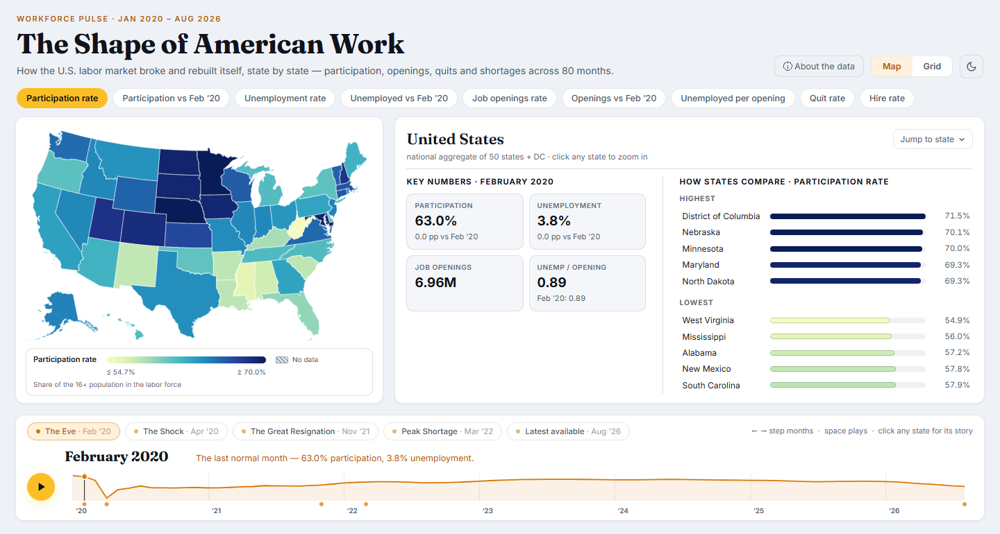

# The Shape of American Work

An interactive atlas of the U.S. labor market from January 2020 through
August 2026, built from U.S. Bureau of Labor Statistics data. It reads
`State-Grid view.csv` directly (51 jurisdictions × 80 months × 17 indicators).
The app does not fetch live data.

**▶ Live demo:** https://efkopru.github.io/workforce-participation/



## Run it

**Double-click `start-app.cmd`** — it starts a tiny dependency-free Node
server ([serve.mjs](serve.mjs)) and opens the app in your browser.
Close its console window to stop the app.

Any other static server works just as well:

- `node serve.mjs` in this folder → http://localhost:8123/
- `python -m http.server` → http://localhost:8000/
- VS Code's *Live Server* **extension** (not built in — install it from the
  Extensions panel first): right-click `index.html` → *Open with Live Server*

A server is required because the app fetches the CSV and its ES modules at
load, and browsers block both on `file://` pages (opening `index.html`
directly shows instructions instead of a blank page). No build step, no
dependencies to install — **editing the CSV and refreshing the page is all
it takes to update the data.**

Every module URL carries the same `?v=` tag (`styles.css` and `js/main.js` in
`index.html`, and each `import` under `js/`), so a browser never pairs a cached
module with a newer one. After changing any of them, replace the tag everywhere
in one find-and-replace — it is `v=20261117` now.

D3 and TopoJSON load from jsDelivr at exact versions with integrity hashes, so
the browser refuses a file that differs from the one the app was tested with.
To move to a newer version, change the version in the `<script>` tag in
`index.html` and replace its `integrity` value with the output of:

```bash
node -e "fetch(process.argv[1]).then(r=>r.arrayBuffer()).then(b=>console.log('sha256-'+require('crypto').createHash('sha256').update(Buffer.from(b)).digest('base64')))" https://cdn.jsdelivr.net/npm/d3@7.9.2/dist/d3.min.js
```

## What you can do

- **Press play** (or space) and watch the years sweep across the map: the COVID
  shock, the Great Resignation, the labor-shortage era, the recovery.
- **Scrub the timeline** — it doubles as a chart of the national trend for the
  selected metric, so spikes show you where to look.
- **Story chapters** — buttons computed *from the data*: peak national
  unemployment, peak quit rate, the tightest unemployed-per-opening ratio,
  and the latest available month. The dots under the timeline open the same
  chapters. A chapter that sets a metric ends when you pick another one.
- **Two map projections** — geographic (Albers) and an equal-size tile grid.
- **Click any state** for sparklines vs. the national average, a live rank
  chip, and its line overlaid on the timeline — or pick it by name from
  *Jump to state* in the side panel (*States* on a phone), which is easier
  than hitting Rhode Island on a small screen.
- **Share what you see** — the URL hash tracks your view, e.g.
  `#m=ur&t=2020-04&s=Michigan` (metric · month · state · `&v=grid` for grid view).
  Pasting such a link into the open atlas switches to that view.
- **Light and dark themes** — opens in the light theme; the moon/sun button
  switches and the choice is remembered in the browser.
- **Phones and tablets** — the layout stacks, the metric and chapter buttons
  scroll sideways in one row, and dragging across the timeline or a state's
  charts changes the month.
- **Keyboard** — `←`/`→` step months, `Space` plays or pauses, `Esc` clears
  the selection. The buttons, the state list and the timeline can all be
  reached with `Tab`; on a button reached that way `Space` presses the
  button, as usual. The timeline is a slider:
  with focus on it, `Home`/`End` jump to the first and last month and
  `PageUp`/`PageDown` move a year. Honors `prefers-reduced-motion`.

## Architecture

One-way data flow: components call **actions**, actions patch the **store**,
the store notifies components with the set of changed keys, and each
component re-renders only what it owns.

```
js/
├─ main.js                boot: load data → store → actions → components
├─ config.js              metric catalogue, state/tile info, formatters
├─ data.js                CSV fetch + parse → national aggregates, color
│                         scales, story chapters (pure data, no DOM)
├─ store.js               ~20-line observable store (shallow-diffed patches)
├─ actions.js             every state transition: seek/play/select/…
├─ permalink.js           URL-hash ⇄ store sync (shareable views)
├─ ui.js                  toast, modal, load-error screen
└─ components/            each subscribes to the store and owns its DOM
   ├─ map.js              geo + tile-grid layers, legend, map note
   ├─ timeline.js         trend-chart scrubber, play button, caption
   ├─ panel.js            national stats / state detail + sparklines
   ├─ chapters.js         story-chapter buttons
   ├─ metricBar.js        metric pills
   ├─ viewToggle.js       map/grid switch
   └─ tooltip.js          hover card
```

## Metrics

| Metric | Notes |
|---|---|
| Participation rate (LFPR) | share of 16+ population in the labor force |
| Participation vs Feb ’20 | percentage points vs the pre-pandemic baseline |
| Unemployment rate | |
| Unemployed vs Feb ’20 | % change in the *number* unemployed |
| Job openings rate | openings ÷ (employment + openings), the JOLTS definition |
| Openings vs Feb ’20 | % change in openings |
| Unemployed per opening | the dataset's "Available Worker Ratio" — **below 1.0 = labor shortage** |
| Quit rate / Hire rate | share of employment (JOLTS); the national rate is the employment-weighted average of the state rates |

Color scales are fixed across all months (clamped at the 2nd–98th
percentile), so colors stay comparable while animating; the legend marks its
two ends `≤` and `≥` because they also stand for every value beyond them.
The map sits on a light surface: every level metric uses one
yellow–green–blue ramp (light = low, dark = high). Change metrics diverge
from a pale midpoint at the Feb 2020 baseline (1.0 for unemployed per
opening): red below it and blue above it, reversed for "Unemployed vs Feb ’20"
so a rise in unemployment reads red. Each side of the midpoint gets half the
ramp, and half the legend bar, whatever range it covers. Missing months are
hatched rather than colored.

In the *How states compare* lists a bar runs from the metric's baseline —
zero, or the midpoint of a change metric — to the state's value, so its length
is the size of the value or of the change.

## Data notes

- Baseline for all "vs pre-pandemic" deltas is **February 2020**; delta series
  begin March 2020.
- **Sources:** BLS Local Area Unemployment Statistics (population, labor
  force, participation, employment, unemployment) and state Job Openings and
  Labor Turnover Survey estimates (openings, hires, quits). Rebuilt on
  September 25, 2026; August 2026 LAUS figures are preliminary.
- **October 2025:** BLS did not publish state LAUS estimates. The CSV keeps
  that month empty; the app fills the labor-force values by straight-line
  interpolation between September and November 2025 (`fillInteriorGaps` in
  `js/data.js`) and labels them as interpolated on the map, timeline and
  tooltip. Job openings, hires and quits for October are published figures.
  Other gaps, such as 2026 JOLTS, are not interpolated.
- **Job openings, hires and quits end in December 2025.** BLS now publishes
  state JOLTS once a year, adding the prior year's monthly figures, so 2026
  months stay empty until the next annual release.
- Counts are in thousands, seasonally adjusted (population is not). National
  figures are recomputed from state sums (rates re-derived, not averaged).
  The quit and hire rates are the exception: BLS divides them by payroll
  employment, which this dataset does not carry, and dividing the national
  counts by the labor-force employment sum would put the nation 0.1–0.2
  points below the states' published rates. The national rate is therefore the
  employment-weighted average of the state rates, which reproduces the BLS
  national rate to its published decimal in about nine months out of ten
  (2.3% quits and 3.9% hires for February 2020, for example).

## Updating the data

`update-data.mjs` rebuilds `State-Grid view.csv` from the BLS bulk files,
keeping the same columns and derived definitions (deltas vs Feb 2020, openings
rate inputs, unemployed per opening, shortage or surplus). BLS asks automated
downloads to identify a contact email:

```powershell
$env:BLS_CONTACT = 'you@example.com'; node update-data.mjs
```

Downloads are cached in `.bls-cache/` (git-ignored); without `BLS_CONTACT` the
script rebuilds from the cache. Afterwards, update the date range in
`index.html` (header, description, About text) and in this README.
